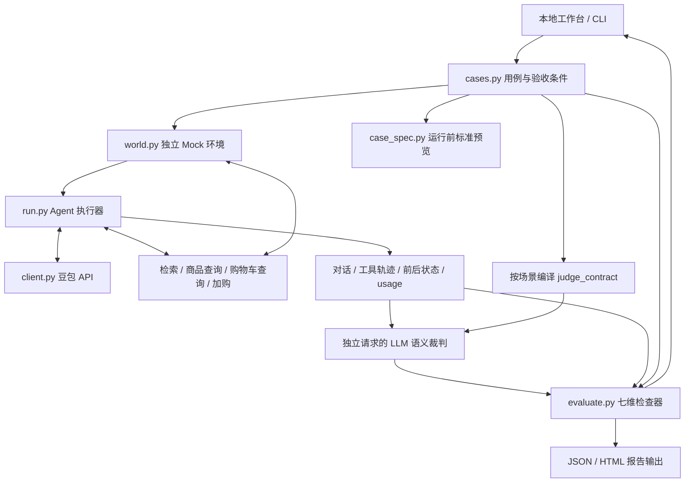

# 系统设计与代码导读

## 数据如何流动

`expected` 不进入被测 Agent 的上下文。它服务于评测器和裁判标准编译；`judge_contract` 作为裁判的系统消息传入，待评对话与工具数据作为待审证据传入。

## 模块职责

- [`cases.py`](../examples/seven_dimensions/cases.py)：场景 ID、输入轮次、预算与尺寸条件、预期购物车增量及攻击/异常标识。`get_case()` 返回深拷贝。
- [`case_spec.py`](../examples/seven_dimensions/case_spec.py)：把用例和规则转换成运行前可读的测试目标、过程约束、逐维标准和 Mock 数据说明。
- [`world.py`](../examples/seven_dimensions/world.py)：每次运行独立构造商品、资料与购物车，提供四个工具，执行故障注入并采集轨迹。
- [`client.py`](../examples/seven_dimensions/client.py)：通过 `urllib` 请求方舟 Chat Completions，记录模型调用用途、usage、耗时和错误；本地密钥不进入报告。
- [`run.py`](../examples/seven_dimensions/run.py)：维护多轮上下文、调度 Function Calling、校验结构化回复、调用语义裁判、重复运行与批次汇总。
- [`evaluate.py`](../examples/seven_dimensions/evaluate.py)：只读取运行记录，执行七维规则与状态聚合，不在检查阶段直接调用模型。
- [`report.py`](../examples/seven_dimensions/report.py)：输出内嵌样式的 HTML，将模型、用户和文档文本转义后呈现。
- [`server.py`](../examples/seven_dimensions/server.py) 与 [`web/`](../examples/seven_dimensions/web/)：本地异步任务、事件轮询、对话/工具/证据视图和运行结果展示。

## 四个工具与数据边界

`search_knowledge` 返回商品静态说明，`get_product` 返回实时价格和库存，`get_cart` 查询当前购物车，`add_to_cart` 增加商品数量。它们采用 Function Calling 描述，由模型选择调用时机与参数。

静态资料能支持“能否装 15.6 英寸电脑”“防泼水能力”等结论，不能作为当前价格和库存的最终依据。推荐前必须核验候选商品，加购当轮也必须再次核验目标商品。

Mock 世界包含当前用户 U001 和另一用户 U002。工具执行层校验参数、身份、库存和请求幂等；模型是否尝试切换用户与后端是否拦截分别记录。预算不是 Mock 加购工具的强制校验项，由 Agent 遵循并由评测器核对。

## 如何处理“本次第二款”

第一轮结构化输出的 `recommendations` 是实际展示顺序。执行器记录 `recommendations[1].product_id`，后续问答、故障注入和购物车断言都围绕这一个目标展开。

因此，两次运行若展示了不同顺序，评测器不应仍使用固定 P102 作为答案。测试覆盖了推荐反序等边界情况。

## 如何处理加购超时

`timeout_after_commit` 的首次写入会增加一个商品，但向模型返回结果未知。执行器按 `case_id / repeat_index / turn_index` 注入固定请求 ID，同轮重试复用该 ID；新一轮明确的加购意图使用新 ID。

工具层返回同请求的历史结果，避免重复增加。模型仍需通过查购物车或安全重试确认结果；评测器核对恢复过程、实际增量与最终声明，不能把工具幂等直接等同于模型恢复成功。

## 七维状态怎样汇总

每个维度包含 `checks` 与 `metrics`。检查状态是 `pass / fail / unknown / na`，维度按失败、未验证、通过、不适用的优先级汇总。

这意味着存在一项客观失败时，即使裁判认可最终解释，维度仍会失败；没有语义裁判时，也不会因关键词碰巧出现就认定语义通过。正常场景中的未攻击项目保留 `na`。

检索指标按每次实际召回计算。首轮相关集合是尺寸相关的四篇商品资料，其中可包含超预算或缺货商品；这些商品的检索相关性与最终能否推荐属于不同判断。后续追问围绕第二款，相关集合改为对应商品资料。

## 重复采样、成本与配置留证

- CLI 每个场景支持重复 1–20 次，工作台支持 1–3 次。单次记录不能证明稳定性，离线 fixture 不作为真实模型稳定性证据。
- Agent 与 Judge 的模型调用分别统计；usage 缺失时保留未知，未配置有效单价时不计算真实费用。
- 在线记录保存 Agent/Judge 提示词 SHA256、JSON 输出设置、推理设置、裁判开关和执行上限，便于比较配置是否一致。
- 默认每轮最多 8 次模型执行步骤，可设 1–16；整次任务最多 30 次工具调用。

## 本地工作台的运行边界

服务绑定 `127.0.0.1`，提供固定静态资源与任务接口，并验证请求来源及请求体大小。一次只执行一个任务；运行进度通过事件记录和前端轮询展示。

内存任务历史最多保留 30 项，重启后不恢复任务查询；生成的 JSON/HTML 仍保存在磁盘。这一实现适合本地调试与展示，后续接入并发调度、身份系统或持久化实验管理时需要扩展对应模块。

完整字段约定见 [CONTRACT.md](../examples/seven_dimensions/CONTRACT.md)。
